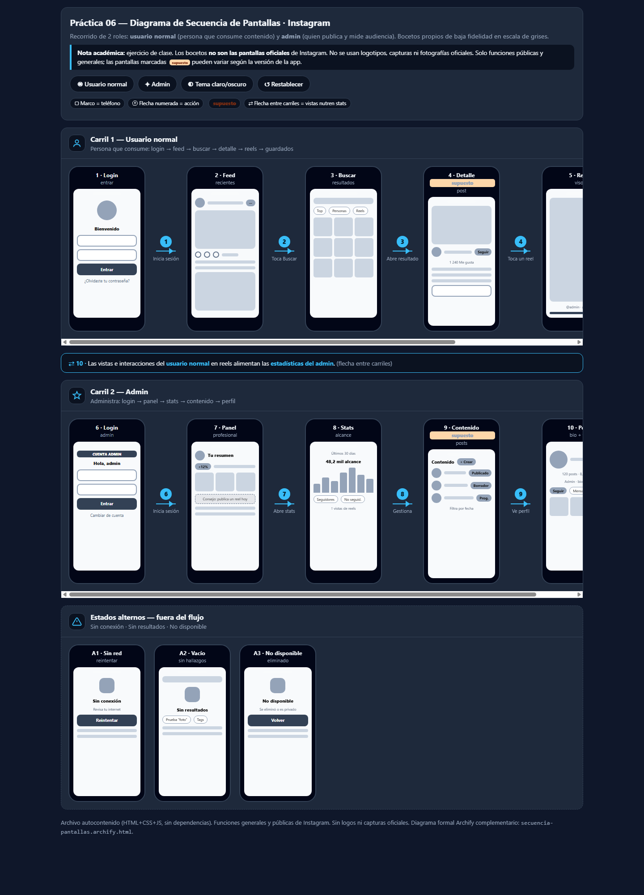
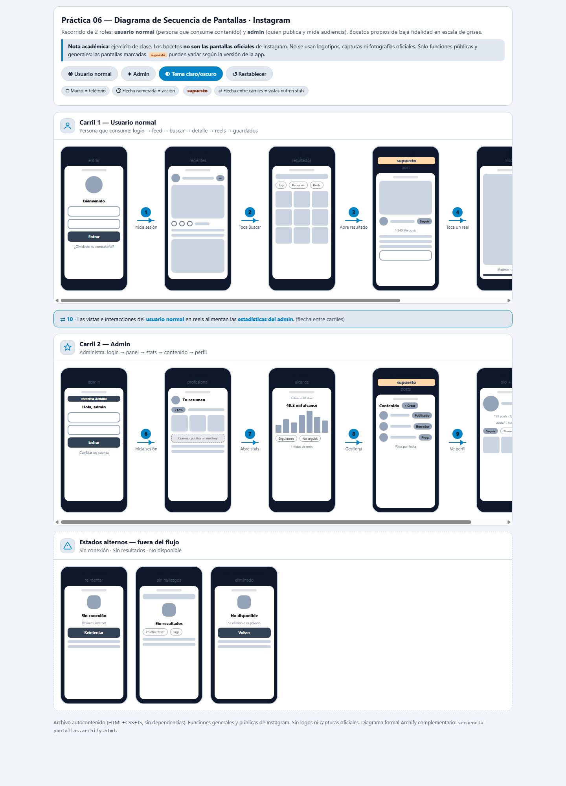
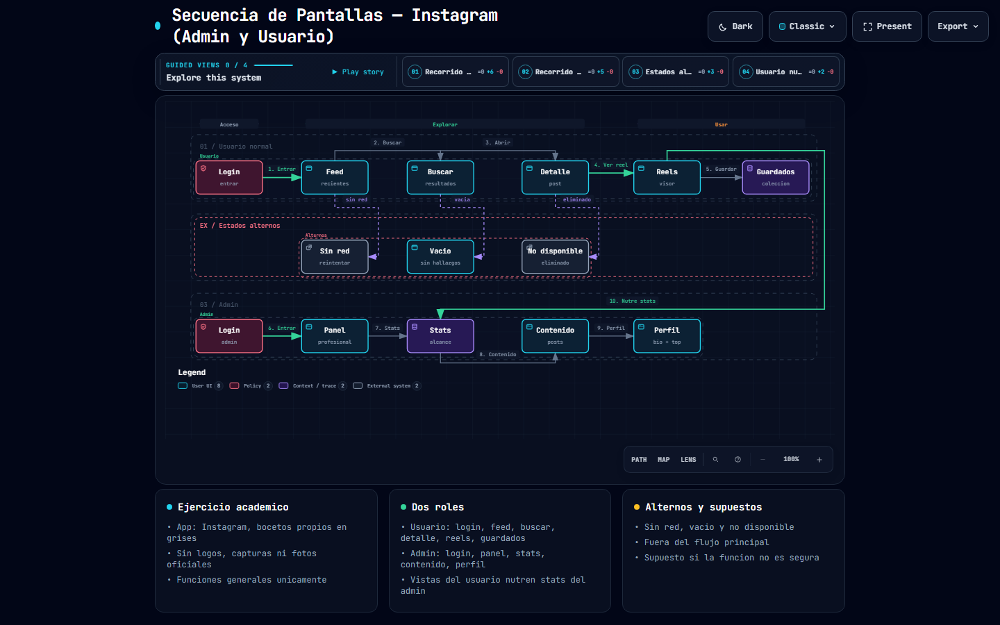
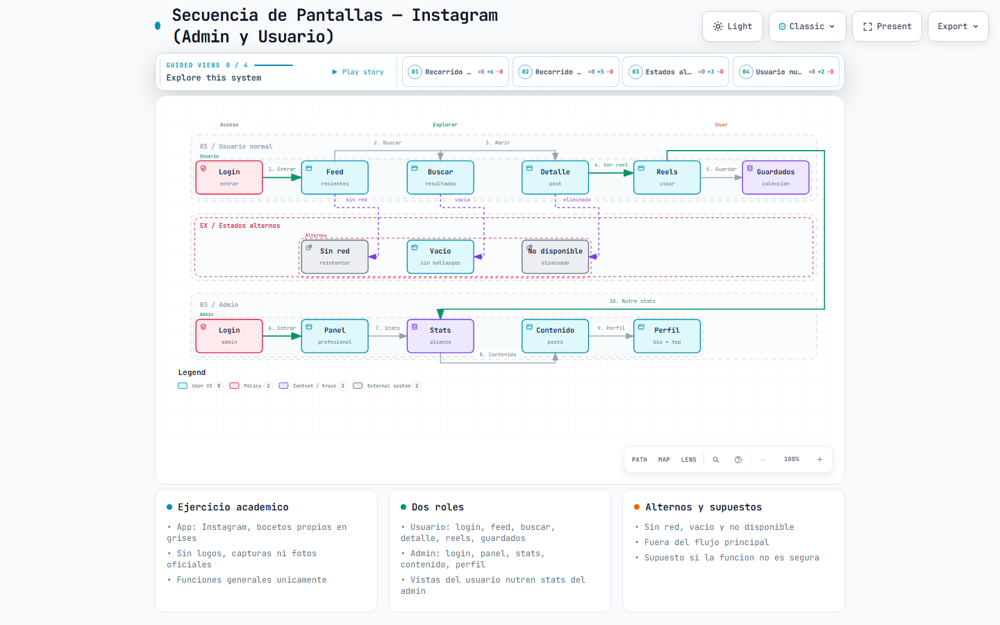

# Práctica 06: Diagrama de Secuencia de Pantallas (Sketches) de Instagram con Archify

> **Universidad Tecnológica de Xicotepec de Juárez (UTXJ)**
> Carrera: Desarrollo de Software · Cuatrimestre: 230314

---

## 🔗 Ver diagramas en línea (GitHub Pages)

▶️ **[Diagrama interactivo de bocetos (pantallas en marcos de teléfono)](https://giova0412.github.io/Practicas_integradora_230314/practica06/diagrama-secuencia-pantallas.html)**

▶️ **[Diagrama formal Archify (workflow de pantallas)](https://giova0412.github.io/Practicas_integradora_230314/practica06/secuencia-pantallas.archify.html)**

---

## 📋 Descripción

Esta práctica modela el **recorrido de pantallas de la app móvil de Instagram** para **2 roles** —**usuario normal** (persona que consume contenido) y **admin** (quien publica y mide audiencia)— con **bocetos propios de baja fidelidad** (wireframes en escala de grises dentro de marcos de teléfono).

> **Nota académica:** ejercicio de clase. Los bocetos **no son las pantallas oficiales** de Instagram. No se usan logotipos, capturas ni fotografías oficiales. Solo funciones públicas y generales; las pantallas marcadas como `supuesto` pueden variar según la versión de la app.

---

## 🤖 Prompt utilizado

```text
Usa Archify para generar el Diagrama de Secuencia de Pantallas (Sketches) de la
aplicación móvil de Instagram, mostrando el recorrido de 2 roles: usuario normal y admin.

Alcance y fidelidad:
- Representa pantallas típicas y reconocibles de cada rol con bocetos propios de
  baja fidelidad (wireframes en escala de grises). No uses logotipos, capturas ni
  fotografías oficiales.
- Basa el contenido solo en funciones públicas y generales de la aplicación;
  no inventes funciones. Marca como "supuesto" cualquier pantalla que no sea segura.
- Indica en una nota que es un ejercicio académico y que los bocetos no son las
  pantallas oficiales.

Estructura del diagrama:
- Dos carriles horizontales (uno por rol), con el nombre y el ícono de cada rol.
- Cada carril contiene los bocetos de las pantallas dentro de marcos de teléfono,
  en el orden del recorrido.
- Rol usuario normal: inicio de sesión → inicio → buscar → detalle → visor de reels →
  guardados.
- Rol admin: inicio de sesión → panel principal → estadísticas de audiencia →
  contenido y publicaciones → perfil.
- Flechas numeradas entre pantallas, con etiqueta breve de la acción que dispara
  el cambio (por ejemplo "Toca un reel").
- Pantallas de estados alternos fuera del flujo principal: sin conexión, búsqueda
  sin resultados y contenido no disponible.
- Una flecha entre carriles que muestre cómo las vistas del usuario normal alimentan
  las estadísticas del admin.

Interacción:
- Al hacer clic en una pantalla, se abre un panel con su nombre, propósito,
  elementos de la interfaz y la acción que lleva a la siguiente pantalla.
- Al seleccionar un rol, se resalta su recorrido y se atenúa el otro.
- Botones para alternar tema claro/oscuro y para restablecer la selección.
```

---

## 🛠️ Herramientas utilizadas

| Herramienta | Propósito |
|---|---|
| **Archify** | Modelo formal del flujo de pantallas (workflow v2) y diagrama interactivo con vistas guiadas por rol |
| **HTML + CSS + JS autocontenido** | Página de bocetos con marcos de teléfono, panel de detalle y resaltado por rol |
| **Git / GitHub** | Control de versiones y publicación mediante GitHub Pages |
| **Chrome headless** | Capturas de evidencia en tema claro y oscuro |

Para replicar la parte de Archify (desde la carpeta del skill):

```bash
node bin/archify.mjs validate workflow practica06/secuencia-pantallas.candidate.json --quality showcase --json
node bin/archify.mjs deliver workflow practica06/secuencia-pantallas.candidate.json practica06/secuencia-pantallas.archify.html --quality showcase --json
node bin/archify.mjs visual-check practica06/secuencia-pantallas.archify.html --json
```

Resultado: validación **showcase 9/9, 0 errores y 0 advertencias** (spec SHA-256 `6c33975c…`, artefacto `7f9db414…`, 822 504 bytes).

---

## 🧭 Recorrido modelado

### Rol usuario normal (consume contenido)

| # | Pantalla | Acción que dispara el cambio |
|---|---|---|
| 1 | Inicio de sesión | 1. Inicia sesión → Feed |
| 2 | Feed / Inicio | 2. Toca Buscar → Buscar |
| 3 | Buscar | 3. Abre resultado → Detalle |
| 4 | Detalle de post *(supuesto)* | 4. Toca un reel → Reels |
| 5 | Visor de reels | 5. Guarda → Guardados |
| 6 | Guardados | Fin del recorrido |

### Rol admin (administra la cuenta)

| # | Pantalla | Acción que dispara el cambio |
|---|---|---|
| 6 | Inicio de sesión (admin) | 6. Inicia sesión → Panel |
| 7 | Panel | 7. Abre stats → Estadísticas |
| 8 | Estadísticas de audiencia | 8. Gestiona → Contenido |
| 9 | Contenido *(supuesto)* | 9. Ve perfil → Perfil |
| 10 | Perfil del admin | Fin del recorrido |

### Entre carriles

- **10. Las vistas e interacciones del usuario normal en reels alimentan las estadísticas del admin.**

### Estados alternos (fuera del flujo principal)

- **A1 · Sin conexión** (reintentar) · **A2 · Búsqueda sin resultados** · **A3 · Contenido no disponible** (eliminado o privado)

---

## 📸 Capturas del diagrama de bocetos

### Tema oscuro



### Tema claro



## 📸 Capturas del diagrama formal Archify

### Tema oscuro — 1440 × 900



### Tema claro — 1440 × 900



---

## 📁 Archivos de la práctica

Dentro de esta carpeta (`practica06`):

- `diagrama-secuencia-pantallas.html` — Página interactiva principal: 14 bocetos distintos en marcos de teléfono, flechas numeradas, panel de detalle por clic, resaltado por rol, temas claro/oscuro y restablecer. Autocontenida y responsive.
- `diagrama-secuencia-pantallas.dark.png` / `.light.png` — Evidencia en ambos temas.
- `secuencia-pantallas.candidate.json` — Fuente del diagrama formal (workflow v2, `quality_profile: showcase`).
- `secuencia-pantallas.archify.html` — Diagrama Archify entregado (3 carriles, 14 nodos, 13 aristas numeradas, 4 vistas guiadas).
- `secuencia-pantallas.archify.visual-check.*` — Evidencia visual automatizada de Archify.

---

## ♿ Accesibilidad y diseño

- Controles operables con teclado, `aria-pressed` en rol/tema, foco visible, textos alternativos y `prefers-reduced-motion`.
- Cursor tipo enlace en pantallas clicables, sin selección de texto en zonas interactivas.
- Desplazamiento horizontal en pantallas pequeñas; ningún texto se sale de los marcos (verificado en capturas 1440px, temas claro y oscuro).

---

## 👤 Autor

**Giovanni** · UTXJ · Desarrollo de Software · 230314
Repositorio: [https://github.com/giova0412/Practicas_integradora_230314](https://github.com/giova0412/Practicas_integradora_230314)
